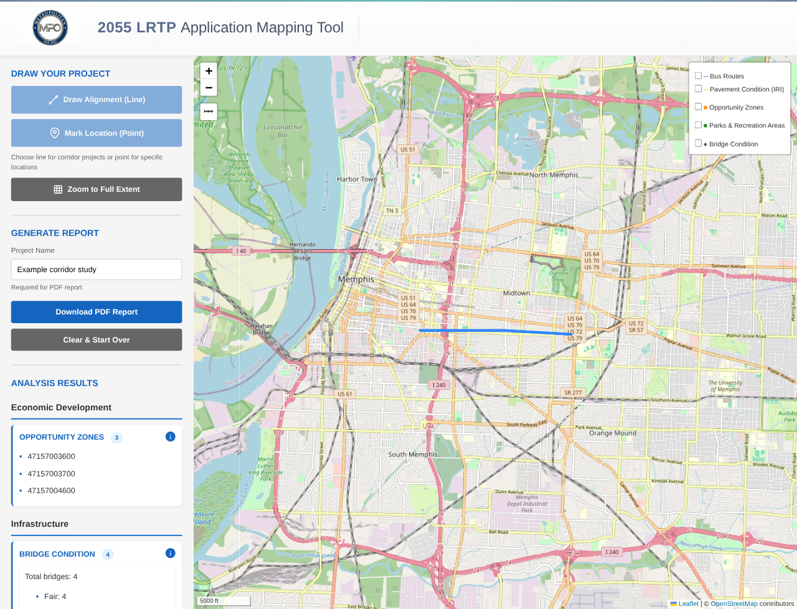

# Simplifying transportation project applications and review

The previous process involved a PDF packet with 29 items, mostly single-page static maps. Applicants had to find their project on each map and answer questions about its relationship to the transportation network and surrounding area. At that scale, locations were approximate, and the map portion took at least 30 minutes per application.

We receive 80–150 applications per cycle. Errors were fairly common, and staff spent almost as long checking the answers as applicants spent preparing them.

I developed MPO Project Mapper for the Memphis Metropolitan Planning Organization’s [Moving Together 2055 Regional Transportation Plan](https://www.memphismpo.org/plans-studies/regional-transportation-plan-rtp/moving-together-2055-regional-transportation-plan) to replace that manual map work. I estimate that drawing the project and staff review now each take well under five minutes per application.

Asking applicants to submit GIS files would have made analysis more straightforward for staff, but introduced file preparation and coordination work for applicants. We also could not assume that rural jurisdictions had GIS staff or software. I wanted a process they could complete with a browser and knowledge of their project’s location.

## Drawing the project once

In the mapper, applicants draw a line for a corridor project or place a point for a specific location. The tool checks that drawing against the reference datasets and displays the results beside the map. Applicants can inspect the layers, enter a project name, and download a PDF containing the map and findings.

The PDF fits into the existing application process. It gives staff a map of the project alongside the answers, without requiring applicants to transfer results into another document. If there is a glitch or a question about the drawing, staff can redraw the project and run the analysis themselves.

Applicant feedback was very positive, and the tool was simple enough to use without training.

*The public demo uses a smaller sample of the Memphis datasets. The alignment shown is an example.*

## Preparing the analysis for applicants

MPO staff prepare the datasets and choose the rules before applicants use the tool. The Memphis implementation covers transportation, economic development, and environmental and cultural features.

I built the analysis around the questions an application needs to answer. For travel time reliability, the tool calculates an average across the road segments matched to the project, weighted by their length. For crash history, it counts fatal and serious injury crashes separately. It also distinguishes a bus route following the project from one crossing it briefly by checking for a minimum length of overlap.

Staff configure those calculations in advance, so applicants can get the answers without selecting GIS operations or calculating summaries themselves. The report supports preliminary review; staff still need to interpret the findings against the project’s scope and check questionable results.

The application can be hosted as ordinary website files, with most processing handled in the browser. For heavier datasets, including flood zones and wetlands, I integrated ArcGIS Online feature services. The tool requests features around the drawn project when needed, so applicants can use those layers without downloading the full datasets at startup.

## Reusing it for other calls for projects

We will reuse the mapper for the next TIP and subsequent RTP cycles. The same approach works for any call for projects that asks applicants to relate a proposed location to mapped data.

To make that reuse practical, I documented the setup and kept the datasets, analysis settings, and branding in YAML configuration files. Planning staff can follow the instructions to update them without a coding background.

I also included more analysis methods than this cycle needed, with flexible rules for matching features, calculating summaries, and presenting results. Those methods support future questions, such as finding the nearest hospital once a suitable dataset is configured. Another agency can use the public version to set up its own region, datasets, and application questions.

[Try the public demo](https://mavrick-f.github.io/mpo-project-mapper/) or [view the source and setup guide](https://github.com/Mavrick-F/mpo-project-mapper).

*Developed with assistance from Claude Code.*
